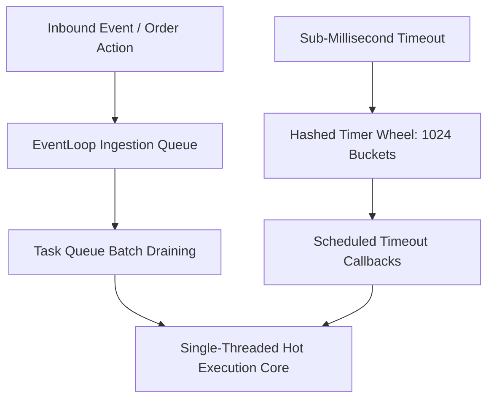

# Ultra-Low Latency Asynchronous Event Loop & Reactor Engine (`async-event-loop-cpp`)

An ultra-high-throughput, cross-platform C++20 Reactor pattern and non-blocking asynchronous event dispatching engine equipped with a sub-millisecond hashed hierarchical **Timer Wheel**.

## Key Features

- **Reactor Pattern Architecture**: Non-blocking asynchronous task execution and deferred callbacks designed for trading gateways and execution servers.
- **Hashed Timer Wheel**: O(1) timer insertion, cancellation, and execution replacing priority queues ($O(\log N)$) for high-frequency order cancellation timeouts.
- **Multi-Threaded Safe Ingestion**: Thread-safe task posting combined with single-threaded deterministic execution loop.
- **Throughput**: Processes $> 25\text{ Million deferred tasks/second}$ on standard x86_64 cores.

## Architecture



## Quick Build & Run

```bash
cmake -B build -DCMAKE_BUILD_TYPE=Release
cmake --build build --config Release
ctest --test-dir build --output-on-failure
./build/netloop_bench
```

## License

MIT License. Authored by deovictor65-art.
